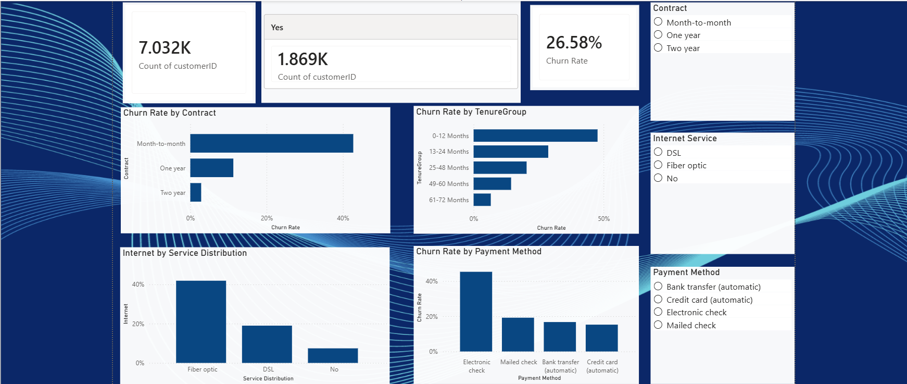
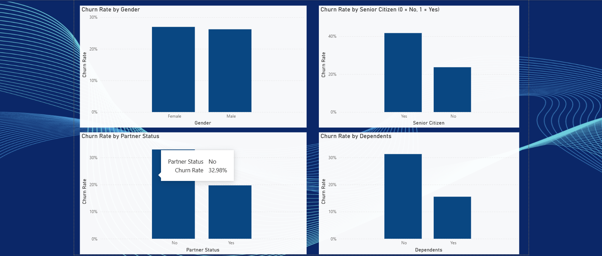

# Customer Churn Analysis & Prediction

## Project Overview

Customer Churn Analysis & Prediction is a Data Analytics and Machine Learning project focused on analyzing customer behavior, identifying churn patterns, and predicting customers who are likely to leave a telecom company.

The project uses Python for data analysis and Machine Learning, and Power BI to create interactive dashboards that help businesses make data-driven retention decisions.

## Business Problem

Customer churn is a major challenge for telecom companies. Losing customers affects revenue and business growth.

The objective of this project is to:

* Analyze customer churn patterns.
* Identify factors associated with customer churn.
* Predict customers who are likely to leave.
* Recommend strategies to improve customer retention.

## Technologies Used

| Technology   | Purpose                      |
| ------------ | ---------------------------- |
| Python       | Data analysis and prediction |
| Pandas       | Data manipulation            |
| NumPy        | Numerical operations         |
| Matplotlib   | Data visualization           |
| Seaborn      | Statistical visualization    |
| Scikit-learn | Machine Learning             |
| Power BI     | Interactive dashboards       |
| Power Query  | Data cleaning                |
| DAX          | Business calculations        |
| Excel        | Data exploration             |
| SQL          | Data querying                |
| Git & GitHub | Version control              |

## Project Structure

```text
Customer-churn-analysis/
│
├── data/
├── dashboard/
├── images/
├── notebooks/
├── sql/
│
├── Business_Insights.txt
├── Model_Evaluation.txt
├── README.md
├── requirements.txt
└── model_comparison.csv
```

## Power BI Dashboard

The interactive Power BI dashboard contains two report pages.
### 1. Customer Churn Overview


### 2. Customer Demographics



### 1. Customer Churn Overview

Key Performance Indicators:

* Total Customers: 7,032
* Churned Customers: 1,869
* Overall Churn Rate: 26.58%

Visualizations:

* Churn Rate by Contract
* Churn Rate by Tenure Group
* Internet Service Distribution
* Churn Rate by Payment Method

Interactive filters:

* Contract
* Payment Method
* Internet Service

### 2. Customer Demographics

Visualizations:

* Churn Rate by Gender
* Churn Rate by Senior Citizen
* Churn Rate by Partner Status
* Churn Rate by Dependents

## Machine Learning

Two Machine Learning models were evaluated to predict customer churn.

### Model Performance

| Metric    | Model 1 | Model 2 |
| --------- | ------: | ------: |
| Accuracy  |  80.31% |  72.71% |
| Precision |  64.56% |  49.17% |
| Recall    |  57.49% |  79.41% |
| F1-Score  |  60.82% |  60.74% |

### Model Selection

Model 2 achieved higher recall at 79.41%, making it a reasonable choice for identifying customers at risk of leaving.

This is important because businesses can take preventive action before customers discontinue their services.

## Key Business Insights

* Month-to-month contract customers show higher churn.
* Customers with shorter tenure are more likely to leave.
* Senior citizens have a higher churn rate.
* Customers without partners or dependents show higher churn.
* Gender differences in churn are relatively small.

## Business Recommendations

* Introduce loyalty programs for existing customers.
* Offer incentives for long-term contracts
